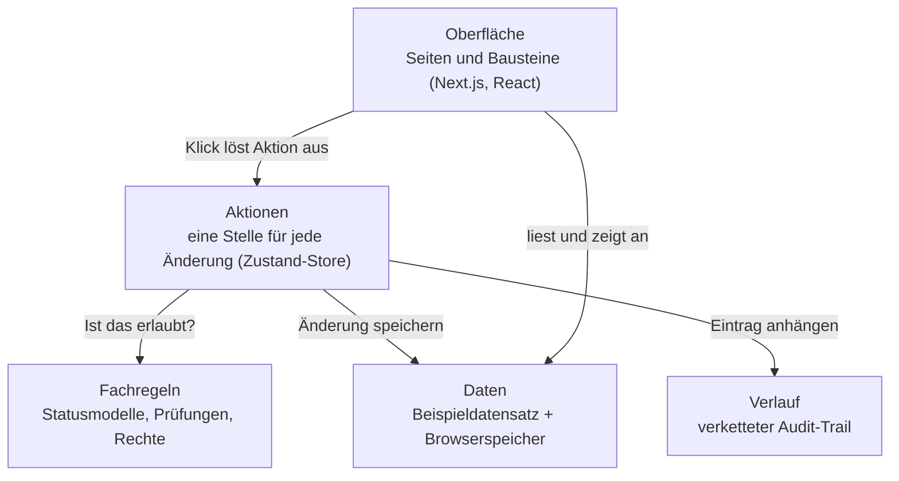

# Audit-Modul: Clickdummy

Klickbarer Dummy eines Audit-Moduls für ESG-, EHS- und GRC-Software. Unternehmen planen, führen und dokumentieren damit interne und externe Audits nach ISO 9001, 14001, 45001 und 50001 sowie Lieferantenaudits. Der Ablauf folgt ISO 19011.

Der Dummy soll drei Dinge zeigen:

1. **Das Datenmodell und seine Verknüpfungen.** Jede Feststellung hängt an Normanforderung, Checklistenpunkt, Nachweis, Maßnahmen und Wirksamkeitsprüfung. Diese Kette ist in der Oberfläche sichtbar und klickbar.
2. **Die Nachvollziehbarkeit jeder Aktion.** Jede Änderung landet in einem fälschungssicher verketteten Verlauf.
3. **Einen fachlich korrekten Workflow.** Statuswechsel sind nur möglich, wenn die fachlichen Voraussetzungen erfüllt sind. Fehlt etwas, nennt die Oberfläche den Grund.

Alle Daten sind erfunden. Das Demo-Unternehmen ist die Muster Metall GmbH mit den Werken Leipzig und Chemnitz.

---

## Inhalt

- [Schnellstart](#schnellstart)
- [Rollen in der Demo](#rollen-in-der-demo)
- [Architektur](#architektur)
- [Teststrecke: Schritt für Schritt](#teststrecke-schritt-für-schritt)
- [Automatische Prüfungen](#automatische-prüfungen)
- [Bewusste Grenzen des Dummys](#bewusste-grenzen-des-dummys)
- [Fachliche Entscheidungen](#fachliche-entscheidungen)
- [Für Entwickler:innen](#für-entwicklerinnen)

---

## Schnellstart

Die Anwendung wird lokal gestartet. Es gibt keinen Login, keine Konten und keine Umgebungsvariablen.

**Lokal starten** (Node.js 20.9 oder neuer):

```bash
npm install
npm run dev
```

Danach `http://localhost:3000` im Browser öffnen.

**Was Sie vorab wissen sollten:**

- **Das Demo-Datum ist fest der 08.10.2026.** Alle Fristen („in 5 Tagen fällig", „überfällig") rechnen von diesem Tag aus. So wirkt die Demo bei jeder Vorführung gleich.
- **Änderungen bleiben nur in Ihrem Browser.** Sie werden im lokalen Browserspeicher abgelegt. Andere Personen sehen sie nicht, und ein anderer Browser startet wieder beim Ausgangszustand.
- **Zurücksetzen:** Oben rechts auf den Namen klicken, dann „Demo zurücksetzen". Danach ist alles wieder im Ausgangszustand, auch der Fortschritt im Demo-Rundgang, und die Rolle ist Sandra Keller.
- **Hilfe:** Das kleine „?" neben Überschriften erklärt den Bereich in zwei, drei Sätzen.
- **Schnellsuche:** Strg K (Windows) oder Cmd K (Mac). Sie springt zu Audits, Feststellungen (F-…), Maßnahmen (M-…), Normkapiteln (z. B. „8.1.3") und Seiten.
- **Demo-Rundgang:** Links unten in der Seitenleiste. Jeder Schritt wechselt die Rolle und öffnet die passende Seite.

---

## Rollen in der Demo

Oben rechts wechseln Sie die Rolle, ohne sich anzumelden. Startseite, sichtbare Buttons und Rechte passen sich der Rolle an. Was eine Rolle nicht darf, ist ausgegraut, und der Tooltip nennt den Grund („Nur für …").

| Person | Rolle | Sieht auf der Startseite | Darf unter anderem |
|---|---|---|---|
| Sandra Keller | Auditprogramm-Verantwortliche | Programmstatus, Audits mit Blockern, fällige Wirksamkeitsprüfungen | planen, Audits durchführen, Berichte freigeben, Kataloge pflegen |
| Jonas Brandt | Auditor | eigene anstehende Audits, unbewertete Checklistenpunkte | Checklisten bewerten (nur zugewiesene Audits), Wirksamkeit prüfen |
| Thomas Richter | Auditee | Feststellungen zur Annahme, angeforderte Nachweise | Feststellungen annehmen oder zurückweisen, Ursachenanalyse, Maßnahmen (eigene Prozesse) |
| Aylin Demir | Maßnahmenverantwortliche | eigene Maßnahmen nach Fälligkeit | eigene Maßnahmen bearbeiten und erledigen |
| Petra Schulz | Geschäftsführung | Programmstatus, freigegebene Berichte | alles lesen, nichts ändern |

---

## Architektur

### In einem Satz

Die Anwendung läuft vollständig im Browser. Es gibt keinen Server, keine Datenbank und keine Schnittstellen. Die Daten liegen als Beispieldatensatz im Code und werden im Browser gespeichert.

### Aufbau in vier Schichten



1. **Oberfläche** (`src/app`, `src/components`): Seiten wie Audit-Detail, Feststellung und Verlauf. Die Oberfläche enthält keine Fachlogik. Sie fragt die Fachregeln, ob ein Button aktiv sein darf, und zeigt die Begründung an, wenn nicht.
2. **Aktionen** (`src/store`): Jede Änderung, auch eine Notiz, läuft über genau eine Aktion. Jede Aktion arbeitet in drei Schritten: Fachregel prüfen, Daten ändern, Verlaufseintrag schreiben. Einen Weg an diesem Muster vorbei gibt es nicht.
3. **Fachregeln** (`src/domain`): Das ist der fachliche Kern. Hier stehen die erlaubten Statuswechsel, die Bedingungen dafür, die Rechte je Rolle, alle deutschen Bezeichnungen und die Hilfetexte. Jede Regel steht an genau einer Stelle.
4. **Daten** (`src/data`, `src/types`): Das Datenmodell und der Beispieldatensatz (7 Audits, 6 Feststellungen, 6 Maßnahmen, 29 Verlaufseinträge, 4 Fragenkataloge). Abgeleitete Werte wie Zähler, Fälligkeiten und Abdeckung werden nie gespeichert, sondern jedes Mal frisch berechnet. So können sie nicht veralten.

### Der Verlauf (Audit-Trail)

- Jede Aktion erzeugt einen Eintrag mit Person, Rolle, Zeit, Zusammenfassung, Vorher-Nachher-Werten und, wo vorgeschrieben, einer Begründung.
- Einträge werden nie geändert oder gelöscht.
- Jeder Eintrag trägt einen Prüfwert (Hash), der den Prüfwert des Vorgängers einschließt. Ändert jemand nachträglich einen alten Eintrag, passt die Kette nicht mehr. Der Button „Integrität prüfen" rechnet die Kette nach und meldet das.
- KI-gestützte Inhalte sind im Verlauf und am Objekt mit „KI-gestützt" gekennzeichnet.

### Datenmodell im Überblick

```
Auditprogramm ── Audit ── Auditplan (Zeitslots)
                   │
                   ├── Checkliste (eingefrorene Kopie eines Fragenkatalogs)
                   │      └── Checklistenpunkt ── Nachweise
                   │               │
                   ├── Feststellung ┘ ── Anforderungen, Prozess, Standort, Risiken, Kennzahlen
                   │      ├── Ursachenanalyse
                   │      ├── Maßnahmen (Korrektur / Korrekturmaßnahme)
                   │      └── Wirksamkeitsprüfung (Vier-Augen-Prinzip)
                   │
                   └── Bericht (Versionen, nach Freigabe unveränderlich)
```

Wichtige Grundsätze im Modell:

- **Checklisten sind Kopien, keine Verweise.** Ändert sich später der Fragenkatalog, bleiben laufende und abgeschlossene Audits unverändert.
- **Freigegebene Berichte sind gesperrt.** Änderungen sind nur über eine neue Version mit Begründung möglich. Die alte Version bleibt sichtbar.
- **Normübergreifendes Mapping** erfolgt über die gemeinsame Grundstruktur der ISO-Normen (Harmonized Structure) und über kuratierte Paare, nie über gleiche Kapitelnummern. Beispiel: Nichtkonformität ist in ISO 50001 Kapitel 10.1, in den anderen drei Normen Kapitel 10.2.
- **Fachliche Nummern** (A-2026-09, F-2026-007, M-2026-007) erscheinen in der Oberfläche, technische IDs nie.

### Technik

Next.js 16 mit React 19 und TypeScript. Zustand verwaltet die Daten, Tailwind CSS und shadcn/ui (Base UI) liefern die Gestaltung. Es gibt keine Umgebungsvariablen und keine externen Dienste.

---

## Teststrecke: Schritt für Schritt

Diese Strecke entspricht dem Vorführungsablauf. Sie dauert etwa 10 bis 15 Minuten. Alle nötigen Daten sind bereits vorhanden.

**So lesen Sie die Tabelle:** Die Spalte „Tun" nennt die Klicks. Begriffe in Anführungszeichen stehen genau so auf dem Bildschirm. Die Spalte „Erwartet" nennt, was Sie sehen sollten. Weicht etwas davon ab, ist das ein Befund.

> Tipp: Wenn Sie sich verklicken, setzen Sie die Demo zurück (Schritt 1) und beginnen neu. Der Demo-Rundgang links unten bringt Sie zu jedem Schritt direkt auf die richtige Seite.

### Schritt 1: Vorbereitung

| Tun | Erwartet |
|---|---|
| Oben rechts auf den Namen klicken, „Demo zurücksetzen" wählen und im Dialog noch einmal „Demo zurücksetzen" klicken. | Meldung „Demo zurückgesetzt". Oben rechts steht Sandra Keller, Auditprogramm-Verantwortliche:r. |

### Schritt 2: Meine Aufgaben

| Tun | Erwartet |
|---|---|
| Startseite ansehen („Meine Aufgaben"). | Unter „Audits mit Blockern" steht A-2026-09 mit dem Kennzeichen „Blockiert". Darunter zwei rote Blocker zu Michael Wagner und eine gelbe Warnung „Michael Wagner ist nicht qualifiziert für ISO 45001." |

**Worum es geht:** Michael Wagner soll ein Audit mitmachen, in dem sein eigener Bereich geprüft wird. Das widerspricht dem Grundsatz, dass niemand die eigene Arbeit auditiert.

### Schritt 3: Abdeckungsmatrix

| Tun | Erwartet |
|---|---|
| In der Seitenleiste „Abdeckungsmatrix" öffnen. Zur Zeile „8.1.3 Management von Veränderungen" (unter ISO 45001) scrollen. | In der Spalte „Werk Leipzig" steht „Nie auditiert" und darunter „Geplant 08.10.2026 A-2026-09" mit dem Kennzeichen „Hoch". |
| Auf diese Zelle klicken. | Rechts öffnet sich ein Bereich mit „Begründung der Risikoeinstufung": Umbau Halle 3, offene Nebenabweichung F-2026-004, zwei Beinaheunfälle mit Flurförderzeugen. |

### Schritt 4: Audit A-2026-09 vorbereiten und starten

| Tun | Erwartet |
|---|---|
| Strg K (oder Cmd K) drücken, „A-2026-09" tippen, Enter. | Audit-Detail, Status „In Vorbereitung". Der Button „Audit starten" ist grau. Darunter ein roter Kasten „2 Blocker, 1 Warnung". |
| Im Abschnitt „Auditteam" bei Michael Wagner auf „Entfernen" klicken. | Meldung „Auditor:in entfernt". |
| Unter „Auditor:in hinzufügen" im Auswahlfeld „Jonas Brandt (ISO 14001, ISO 45001)" wählen und „Zuweisen" klicken. | Meldung „Auditor:in zugewiesen". Der rote Kasten ist verschwunden, „Audit starten" ist jetzt aktiv. |
| „Audit starten" klicken. | Meldung „Audit gestartet". Status „In Durchführung". |

### Schritt 5: Checkliste bewerten

| Tun | Erwartet |
|---|---|
| Den Tab „Checkliste" öffnen. | Ganz oben steht der Punkt „Ü1" mit dem Vermerk „Übernahme" und der Feststellung F-2026-004 aus dem Vorjahr. |
| Punkt 4 suchen („Werden Gefährdungsbeurteilungen bei Änderungen …"). | Unter der Frage steht bereits ein Nachweis „Gefährdungsbeurteilung Intralogistik Halle 3, Stand 11/2025 von Thomas Richter". Ihn hat der Auditee vor dem Audit bereitgestellt. |
| Bei Punkt 4 rechts „Abweichung" klicken. | Meldung „Punkt 4 bewertet: Abweichung". Unter den Bewertungsknöpfen erscheint „Feststellung anlegen". |
| „Notiz und Nachweise" aufklappen, „Foto anhängen" klicken. Eine Bezeichnung eingeben (z. B. „Gasse 4 ohne markierten Fußgängerweg"), „Beispielfoto verwenden" und dann „Anhängen" klicken. | Meldung „Foto angehängt". Am Punkt steht jetzt „(2 Nachweise)". |
| „Feststellung anlegen" klicken. | Rechts öffnet sich das Formular „Feststellung anlegen". |

### Schritt 6: Feststellung erfassen

| Tun | Erwartet |
|---|---|
| Den Abschnitt „1 Bezug" ansehen. | Vorbefüllt sind die Anforderungen ISO 45001 6.1.2 und 8.1.3, der Prozess „Intralogistik und Lager Leipzig" und der Standort. |
| Bei „Stichpunkte" ein paar Wörter eingeben, dann „Mit KI formulieren" klicken. | Kurz „KI-Vorschlag wird erstellt", dann ein abgesetzter Vorschlag mit Titel und Beschreibung sowie den Buttons „Übernehmen", „Bearbeiten" und „Verwerfen". |
| „Übernehmen" klicken. | Kurztitel und Beschreibung sind ausgefüllt, mit dem Label „KI-gestützt". |
| Bei „Klassifizierung" die Option „Nebenabweichung" wählen. „Verantwortliche:r" ist bereits Thomas Richter. Bei „Frist" den 13.11.2026 eintragen. | Die Hinweiszeile „Noch offen: …" unten verschwindet. |
| „Verknüpfungen vorschlagen" klicken, dann „Übernehmen". | Es erscheinen die Chips „R-012 Kollision Flurförderzeug mit Fußgänger:innen in Halle 3" und „KPI-AS-02 Beinaheunfälle mit Flurförderzeugen". |
| Unten „Speichern" klicken. | Meldung „Nebenabweichung F-2026-007 erfasst". Am Checklistenpunkt hängt jetzt F-2026-007. |

### Schritt 7: Verlauf des Audits

| Tun | Erwartet |
|---|---|
| Den Tab „Verlauf" öffnen. | Jede Aktion seit Schritt 4 steht dort, neueste oben, jeweils mit Zeit, Person, Rolle, Zusammenfassung und gekürztem Hash. Die beiden KI-Einträge tragen das Label „KI-gestützt". Statuswechsel zeigen „vorher → nachher". |

### Schritt 8: Rollenwechsel zum Auditee

| Tun | Erwartet |
|---|---|
| Oben rechts auf den Namen klicken und „Thomas Richter" wählen. | Startseite von Thomas Richter. Unter „Feststellungen zur Annahme" steht F-2026-007. |
| F-2026-007 anklicken. | Feststellungsseite mit der Nachweiskette oben. Thomas Richter sieht keinen „Bearbeiten"-Button am Feststellungstext: Den Text formuliert das Auditteam. |
| „Annehmen" klicken. | Meldung „Feststellung angenommen". |
| Im Abschnitt „Ursachenanalyse" auf „Ursachenanalyse vorschlagen" klicken, dann „Übernehmen". | Eine 5-Why-Analyse mit Ursache, gekennzeichnet „KI-gestützt". |
| „Maßnahme anlegen" klicken. Art: „Korrektur", Titel: „Fußgängerwege in Halle 3 provisorisch markieren", Verantwortliche:r: Aylin Demir, Frist: 16.10.2026. Dann „Maßnahme anlegen". | Meldung „Korrektur angelegt". Oben ist „In Bearbeitung setzen" noch gesperrt. Der Hinweis erklärt, dass eine Korrektur allein die Ursache nicht beseitigt. |
| Noch einmal „Maßnahme anlegen". Art: „Korrekturmaßnahme", Titel: „Prüfung der Arbeitsschutzauswirkungen als Pflichtschritt im Änderungsprozess", Verantwortliche:r: Thomas Richter, Frist: 13.11.2026. Dann „Maßnahme anlegen". | Meldung „Korrekturmaßnahme angelegt". |
| Oben „In Bearbeitung setzen" klicken. | Status „In Bearbeitung". |

**Worum es geht:** Eine Korrektur beseitigt das Symptom, eine Korrekturmaßnahme die Ursache. Die Anwendung trennt beide und verlangt mindestens eine Korrekturmaßnahme.

### Schritt 9: Bericht erstellen und freigeben

| Tun | Erwartet |
|---|---|
| Rolle zurück zu „Sandra Keller". A-2026-09 öffnen (Strg K) und den Tab „Checkliste" wählen. | 1 von 13 Punkten bewertet. |
| „Übrige als konform markieren" klicken und im Dialog „Als konform markieren" bestätigen. | Meldung „12 Punkte als konform markiert". Diese Abkürzung gibt es nur für die Vorführung, im Verlauf ist sie als „Demo-Aktion" gekennzeichnet. |
| Oben rechts „Berichtserstellung starten" klicken. | Meldung „Berichtserstellung gestartet". |
| Den Tab „Bericht" öffnen, „Berichtsentwurf erzeugen" klicken, dann „Übernehmen". | Ein Berichtsentwurf mit Zusammenfassung, Gesamtbewertung und Stärken. |
| „Zur Prüfung einreichen" klicken. | Es erscheinen „Bericht freigeben" und „Zurück in den Entwurf". |
| „Bericht freigeben" klicken. | Meldung „Bericht freigegeben". Audit-Status „Bericht freigegeben". Ein grauer Kasten „Bericht gesperrt" mit Inhaltshash. Der einzige Bearbeitungsweg ist jetzt „Neue Version anlegen" (mit Pflichtbegründung). |
| Zum Vergleich A-2026-05 öffnen, Tab „Bericht". | Tabelle „Berichtsversionen" mit Version 2 (Freigegeben) und Version 1 (Ersetzt) samt Änderungsgrund. Darunter ein Vergleich, der Änderungen markiert. |

### Schritt 10: Vier-Augen-Prinzip bei der Wirksamkeitsprüfung

| Tun | Erwartet |
|---|---|
| F-2026-005 öffnen (Strg K, „F-2026-005"). | Feststellung im Status „Wirksamkeitsprüfung". |
| Im Abschnitt „Wirksamkeitsprüfung" das Ergebnis „Wirksam" wählen, einen kurzen Kommentar eingeben und „Wirksamkeitsprüfung durchführen" klicken. | Meldung „Wirksamkeitsprüfung durchgeführt". Bei „Prüfung durchgeführt von" steht Sandra Keller. |
| Den Button „Schließen" oben ansehen. | „Schließen" bleibt grau. Blocker: „Bestätigung durch eine zweite Person fehlt." Auch „Bestätigung durch zweite Person" ist für Sandra Keller gesperrt, weil sie selbst geprüft hat. |
| Optional: Rolle „Jonas Brandt" wählen, F-2026-005 öffnen, „Bestätigung durch zweite Person" und danach „Schließen" klicken. | Die Feststellung ist geschlossen. |

### Schritt 11: Integrität des Verlaufs

| Tun | Erwartet |
|---|---|
| In der Seitenleiste „Verlauf" öffnen und „Integrität prüfen" klicken. | Grüner Kasten „Kette lückenlos", darunter „… Einträge geprüft, Kette vollständig und unverändert." |

### Schritt 12 (optional): Fragenkataloge und Mapping

| Tun | Erwartet |
|---|---|
| Im Demo-Rundgang den Schritt „Kataloge und Mapping" wählen (oder Strg K, „ISO 45001 10.2"). | Der Katalog „Kombi-Audit Umwelt und Arbeitsschutz, Produktion" öffnet sich im Tab „Anforderungen und Mapping". |
| Die Zeile ISO 45001 10.2 ansehen. | Als gleichwertig gelistet sind ISO 9001 10.2, ISO 14001 10.2 und ISO 50001 10.1 (Grundlage: Harmonized Structure). |
| Den Tab „Versionen" öffnen. | Version 2 (Außer Kraft) und Version 3 (Freigegeben) mit Änderungsgrund, darunter „Versionen vergleichen". |

### Weitere Dinge, die Sie ausprobieren können

- **Negativfälle:** Ein Audit ohne Begründung absagen, eine Feststellung ohne Begründung zurückweisen, „nicht wirksam" ohne Kommentar speichern. Alle drei werden abgewiesen.
- **Rechte:** Als Petra Schulz (Geschäftsführung) durch die Seiten gehen. Alles ist lesbar, aber kein Button ist aktiv. Der Tooltip nennt den Grund.
- **Kataloge pflegen:** Als Sandra Keller einen Katalog öffnen, „Neue Version anlegen", eine Frage ändern und mit Begründung freigeben. Laufende Audits behalten ihre alte Checkliste.

---

## Automatische Prüfungen

Neben der Teststrecke von Hand gibt es vier automatische Prüfungen. Jede läuft mit einem Befehl im Projektordner. Fehlerfrei bedeutet: Der Befehl meldet keinen Fehler.

| Befehl | Was er prüft, einfach gesagt |
|---|---|
| `npm run validate:seed` | Ist der Beispieldatensatz in sich stimmig? Zum Beispiel: Hat jede Feststellung Anforderung, Prozess und Standort? Verweisen Feststellung und Checklistenpunkt gegenseitig aufeinander? Ist jede geschlossene Abweichung von zwei verschiedenen Personen als wirksam bestätigt? Ist die Verlaufskette unverändert? |
| `npm run demo:check` | Spielt die Teststrecke (Schritte 4 bis 12) automatisch gegen die Fachlogik durch, über 60 Einzelprüfungen. Dazu gehört auch, dass Verbotenes wirklich abgewiesen wird, zum Beispiel ein Bericht ohne Prüfung freigeben oder die eigene Wirksamkeitsprüfung selbst bestätigen. Am Ende wird der ganze Datenbestand erneut auf Stimmigkeit geprüft. |
| `npm run typecheck` | Passen alle Programmteile formal zusammen (TypeScript)? |
| `npm run lint` | Hält der Code die vereinbarten Regeln ein? |

**Zusätzlich in der Qualitätssicherung (Oktober 2026):** Die komplette Teststrecke wurde mit einem ferngesteuerten Browser (Playwright) Klick für Klick durchgespielt. Außerdem wurden 39 Seitenaufrufe (alle Seiten, auch mit Filtern und ungültigen Adressen) mit allen 5 Rollen durchgeführt. Dabei gab es keine Fehlermeldungen. Geprüft wurden auch die Rechte je Rolle, Negativpfade, Tablet- und Handybreite sowie die Sprachregeln (keine englischen Texte, keine internen Statuscodes). Diese Browserprüfung ist nicht Teil des Repositorys.

---

## Bewusste Grenzen des Dummys

Der Dummy zeigt Konzept und Workflow. Folgendes ist absichtlich nicht gebaut:

| Bereich | Im Dummy | Im Produkt |
|---|---|---|
| Server und Datenbank | keine, alles läuft im Browser | zentrale Datenhaltung für alle Nutzer:innen |
| Anmeldung und Rechte | Rollenwechsel ohne Login. Rechte werden nur in der Oberfläche gesteuert (Buttons aus oder gesperrt). | SSO, serverseitig durchgesetzte Rechte, Gastzugänge für externe Auditor:innen |
| Speicherung | nur im eigenen Browser, „Demo zurücksetzen" stellt den Ausgangszustand her | dauerhaft und für alle sichtbar |
| Datei-Uploads | simuliert: Dateiname und Größe werden übernommen, die Datei selbst nicht | echte Ablage mit Virenscan und Aufbewahrungsfristen |
| KI-Funktionen | vorbereitete Vorschläge ohne echten KI-Aufruf. Verfügbar für das Demo-Audit A-2026-09 (Feststellungstext, Verknüpfungen, Ursachenanalyse, Berichtsentwurf). | echtes Sprachmodell, gleicher Ablauf: Vorschlag, prüfen, übernehmen oder verwerfen, Kennzeichnung |
| Prüfwert (Hash) im Verlauf | bewusst einfacher Demo-Hash, nicht kryptografisch | SHA-256 serverseitig, optional mit qualifiziertem Zeitstempel |
| Datum | fest auf den 08.10.2026 gesetzt. Die Uhrzeit neuer Einträge ist die echte Uhrzeit. | echtes Datum |
| Normtexte | nur Kapitelnummer und Kurztitel, weil Normtexte urheberrechtlich geschützt sind (ISO, DIN) | Anbindung lizenzierter Normtexte möglich |
| Maßnahmenquellen | nur Maßnahmen aus Feststellungen | das Modell ist offen für Vorfälle und Reklamationen |

Die Seite „Integrationen" in der Anwendung listet Punkte, die im Konzept beschrieben, aber nicht Teil des Dummys sind: REST-API und Webhooks, SSO und Gastzugänge, Excel-Import bestehender Checklisten, PDF-Export mit Signatur, Lieferantenportal, Offline-Modus für die Durchführung vor Ort und Übergabe von Kennzahlen an das ESG-Reporting.

**Bekannte Eigenheiten:**

- „Übrige als konform markieren" ist eine Abkürzung für die Vorführung und im Verlauf als „Demo-Aktion" gekennzeichnet.
- Die Oberfläche ist für Desktop und Tablet ausgelegt. Am Handy ist sie bedienbar: Die Tabs brechen in eine zweite Zeile um, und breite Tabellen (z. B. im Dashboard und im Mapping der Kataloge) scrollen innerhalb ihres Rahmens seitlich.
- Wer zwischen Browsern oder Geräten wechselt, sieht jeweils einen eigenen Datenstand.

---

## Fachliche Entscheidungen

Diese Punkte wurden bei der Qualitätssicherung geschärft. Sie sind auch in [CLAUDE.md](CLAUDE.md) festgehalten.

- **Eine Abweichung schließt nur über die Wirksamkeitsprüfung.** Das gilt auch, wenn der Auditee sie zurückgewiesen hat. Wird die Zurückweisung akzeptiert, ändert das Auditteam die Klassifizierung (z. B. zu Beobachtung) oder übergibt die Feststellung erneut.
- **„Zurück in Bearbeitung" aus der Wirksamkeitsprüfung** gibt es nur bei Ergebnis „nicht wirksam" und mit Begründung.
- **Während der Wirksamkeitsprüfung sind die Maßnahmen eingefroren.** Sie werden weder geändert noch neu angelegt, damit geprüft wird, was tatsächlich umgesetzt wurde.
- **Ein Audit wird erst abgeschlossen,** wenn alle Abweichungen geschlossen sind und die aktuelle Berichtsversion freigegeben ist.
- **Nach dem Einreichen des Berichts** kann das Audit nicht mehr zurück in die Durchführung. Der Bericht selbst kann mit Begründung zurück in den Entwurf.
- **Bei einer neuen Berichtsversion** gilt die bisherige Version sofort als „Ersetzt". Die neue Version startet als Entwurf.
- **Auditees nehmen Feststellungen an oder weisen sie zurück, formulieren sie aber nicht um.** Maßnahmen erledigen sie nur in ihren eigenen Prozessen.

---

## Für Entwickler:innen

```bash
npm install
npm run dev             # Entwicklungsserver, http://localhost:3000
npm run build           # Produktions-Build
npm run validate:seed   # Integrität des Beispieldatensatzes
npm run demo:check      # Teststrecke gegen die Fachlogik
npm run typecheck
npm run lint
```

| Ordner | Inhalt |
|---|---|
| `src/types/domain.ts` | Datenmodell, einzige Quelle für Typen |
| `src/domain/` | Fachregeln: Statusmodelle (`workflows.ts`), Prüfungen (`rules.ts`), Rechte (`permissions.ts`), Bezeichnungen (`labels.ts`), Hilfetexte (`help.ts`), Rundgang (`tour.ts`) |
| `src/store/` | Aktionen (`commands/`), abgeleitete Werte (`selectors.ts`), Store |
| `src/lib/audit-trail.ts` | Verlauf: Einträge anhängen, Kette prüfen |
| `src/data/` | Beispieldatensatz, Integritätsprüfung, vorbereitete KI-Vorschläge |
| `src/components/`, `src/app/` | Oberfläche und Seiten |
| `scripts/` | `validate-seed.ts` und `demo-walkthrough.ts` |

Die verbindliche Arbeitsgrundlage mit Glossar, Invarianten, Statusmodellen, Rechte-Matrix und Gestaltungsregeln steht in [CLAUDE.md](CLAUDE.md).
